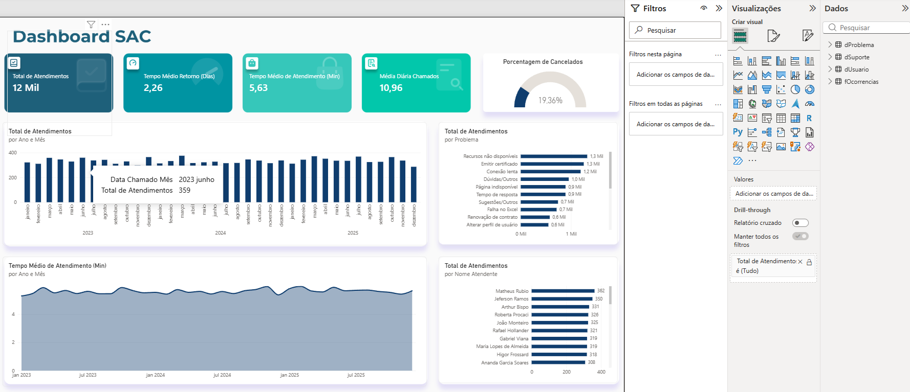

# Dashboard SAC — Análise de Atendimentos de Suporte (Power BI)

Dashboard em Power BI para acompanhar a operação de um SAC (Serviço de Atendimento ao Cliente): volume de chamados, tempo de atendimento, tempo de retorno ao usuário, taxa de cancelamento, principais problemas e desempenho por atendente.



## Perguntas que o painel responde

- Quantos atendimentos o SAC recebe, e qual é a média por dia?
- Quanto tempo dura, em média, um atendimento? E quantos dias o usuário espera pela resposta?
- Que percentual dos chamados termina cancelado?
- Quais problemas geram mais chamados?
- Como o volume se distribui entre os atendentes?
- O volume e o tempo de atendimento mudam ao longo dos meses e anos?

## Os dados

Arquivo `dados/Base SAC.xlsx`, com 4 abas:

| Aba | Tipo | Conteúdo |
|---|---|---|
| `fOcorrencias` | Fato | 11.999 chamados entre jan/2023 e dez/2025: datas de chamado e resposta, hora inicial e final, usuário, atendente, problema e status |
| `dUsuario` | Dimensão | 450 usuários (sexo, data de nascimento, data de inscrição) |
| `dSuporte` | Dimensão | 44 atendentes |
| `dProblema` | Dimensão | 21 tipos de problema (conexão lenta, emitir certificado, problema com login, reembolso etc.) |

Status possíveis de um chamado: **Encerrado**, **Cancelado** e **Aguardando resposta do usuário**.

## Modelagem

Modelo em estrela, com a tabela fato no centro e relacionamentos muitos-para-um (direção única):

```
dUsuario  ──┐
dSuporte  ──┼──< fOcorrencias
dProblema ──┘
```

- `fOcorrencias[ID Usuario]` → `dUsuario[Codigo Usuario]`
- `fOcorrencias[ID Suporte]` → `dSuporte[Codigo Suporte]`
- `fOcorrencias[ID Problema]` → `dProblema[Codigo Problema]`

## Tratamento no Power Query

**fOcorrencias**
- Removidas colunas e linhas em branco do cabeçalho do relatório exportado e promovidos os cabeçalhos corretos
- Ajuste de tipos de dados (datas, horas, inteiros, texto)
- Nova coluna **Tempo Atendimento (Min)**: diferença entre hora final e inicial, convertida para minutos e arredondada em 2 casas
- Nova coluna **Quantidade de dias pra Resposta**: diferença em dias entre data da resposta e data do chamado
- Remoção das colunas de hora, já resumidas nas colunas acima

**dUsuario**
- Nome reorganizado de "Sobrenome, Nome" para "Nome Sobrenome"
- Sexo padronizado ("M"/"F" → "Masculino"/"Feminino")
- Coluna **Idade** calculada a partir da data de nascimento
- Coluna condicional **Faixa Etária** (Jovem até 29, Adulto de 30 a 39, Senior a partir de 40)

## Medidas DAX

```DAX
Total de Atendimentos = COUNTROWS(fOcorrencias)

Tempo Médio de Atendimento (Min) = AVERAGE(fOcorrencias[Tempo Atendimento (Min)])

Tempo Médio Retorno (Dias) = AVERAGE(fOcorrencias[Quantidade de dias pra Resposta])

Média Diária Chamados =
    [Total de Atendimentos] / DISTINCTCOUNT(fOcorrencias[Data Chamado])

Chamados Cancelados =
    CALCULATE([Total de Atendimentos], fOcorrencias[Status] = "Cancelado")

Porcentagem de Cancelados = [Chamados Cancelados] / [Total de Atendimentos]
```

## Visuais do dashboard

| Visual | O que mostra |
|---|---|
| 4 cartões | Total de atendimentos, tempo médio de atendimento, média diária de chamados e tempo médio de retorno |
| Medidor (gauge) | Porcentagem de chamados cancelados |
| Colunas (ano e mês) | Evolução do total de atendimentos |
| Área (ano e mês) | Evolução do tempo médio de atendimento |
| Barras por problema | Ranking dos tipos de problema |
| Barras por atendente | Atendimentos por atendente |

Também há um plano de fundo personalizado, tema de cores customizado, botão de navegação e página configurada para drill-through.

## Principais números

Valores calculados sobre toda a base (2023 a 2025):

| Indicador | Valor |
|---|---|
| Total de atendimentos | 11.999 |
| Média diária de chamados | ≈ 11 |
| Tempo médio de atendimento | ≈ 5,6 minutos |
| Tempo médio de retorno | ≈ 2,3 dias |
| Chamados cancelados | 19,4% (2.323 chamados) |
| Aguardando resposta do usuário | 7,8% (933 chamados) |

## Insights

- **Volume estável:** cerca de 4 mil chamados por ano (4.000 em 2023, 3.950 em 2024 e 4.049 em 2025), sem sazonalidade forte.
- **Problemas concentrados:** "Recursos não disponíveis" (1.322), "Emitir certificado" (1.253) e "Conexão lenta" (1.191) somam cerca de 31% dos chamados. Soluções de autoatendimento ou correções nesses pontos teriam o maior impacto na redução de demanda.
- **Cancelamento alto:** quase 1 em cada 5 chamados termina cancelado, o que merece investigação (causa do cancelamento, tempo de espera até o cancelamento etc.).
- **Distribuição entre atendentes:** o volume por atendente varia de 193 a 362 chamados, o que pode indicar desequilíbrio na distribuição da carga.

## Próximos passos (ideias de evolução)

- Criar tabela calendário própria e medidas de inteligência de tempo (variação vs. ano anterior)
- Analisar o cancelamento por tipo de problema e por atendente
- Usar o perfil dos usuários (faixa etária, sexo, tempo de inscrição) na análise
- Publicar o relatório na web com link interativo

## Ferramentas

Power BI Desktop · Power Query (M) · DAX · Excel

## Como abrir

1. Baixe `Dashboard_SAC.pbix` e `dados/Base SAC.xlsx`
2. Abra o `.pbix` no Power BI Desktop
3. Se pedir, atualize o caminho da fonte em **Transformar dados > Configurações da fonte de dados** apontando para o `Base SAC.xlsx` no seu computador

## Autor

**Rayner Carvalho** (complete com seu nome completo) — [LinkedIn](https://www.linkedin.com/in/raynercarvalho/)
